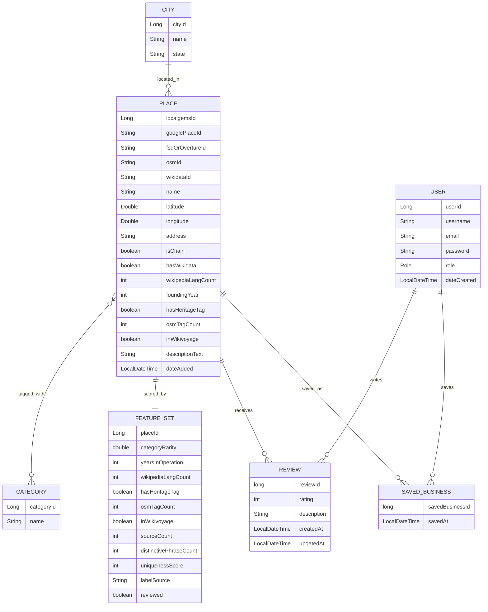
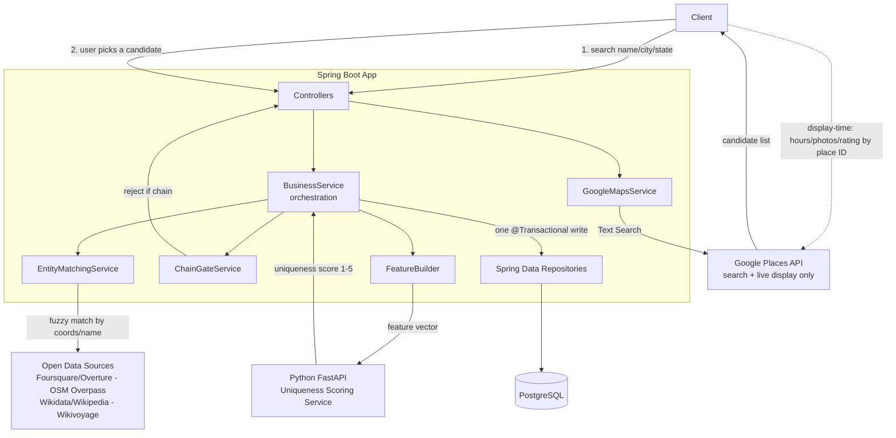

# LocalGems (On Pause)

LocalGems aims to be a platform where users can easily share and discover local and niche shops in their area or while traveling on vacation.

> **Status:** Work in Progress – Backend under active development  

## MVP Features (Planned / In Progress)
- User registration & login (Spring Security)
- User ability to submit a local business
  - User picks the correct Google Places match from search candidates (no auto-pick)
  - Candidate is cross-matched against open data sources (Foursquare/Overture, OSM, Wikidata)
  - **Chain gate** rejects chains outright; everything else gets a **uniqueness score (1–5)** from a classical ML model — no LLM moderation
  - Category assigned by lookup from source type tags, not ML
- Business search functionality
  - Search by category, city, ratings, and name
  - Google Maps API for a search map (display only — live details fetched by place ID, not stored)
- Users leaving reviews and ratings for businesses
- Users being able to save businesses  

## Possible Future Features
- RAG-based semantic search over businesses, narrowed by structured filters
- MCP-based "tour guide" conversational agent (search by criteria, place details, find nearby)
- Recommendation system (classical ML, separate from the uniqueness scorer)
- Mobile app
- Reddit-style forum page for each city and category
- Admin panel for verified business owners
  - analytics dashboard for their page

## Tech Stack
- **Backend:** Java, Spring Boot
- **ML Scoring Service:** Python, FastAPI, scikit-learn, pandas, joblib (separate service, called over REST)
- **Database:** PostgreSQL
- **APIs / Data Sources:** Google Places (search + live display only, not stored long-term), Foursquare OS Places or Overture Maps, OpenStreetMap (Overpass), Wikidata/Wikipedia, Wikivoyage
- **Deployment:** AWS EC2, Docker

> **Architecture note:** business submission moderation no longer uses an LLM. The old plan (OpenAI validates + categorizes each submission) is replaced by a hard chain gate plus a classical ML uniqueness-scoring model trained on open geographic/knowledge-base data. LLM use is repositioned to conversational retrieval (RAG search, tour-guide chatbot) rather than per-submission moderation. See the full spec doc (local-only, gitignored) for the complete rationale and data model.

## Architecture

### Data model



`PLACE` is the merged record (what sources said — renamed/expanded from the old `BUSINESS` entity). `FEATURE_SET` holds the numbers the ML model actually sees, kept separate so features can be rebuilt without re-calling any external API. Category is assigned by lookup from source type tags, not by a model.

### Request flow & external integrations



**Business submission flow (new):** the user searches by name/city/state; `GoogleMapsService` returns several Places candidates instead of auto-picking one; the user confirms the correct match. That anchor (coordinates + name) is used only transiently to cross-match against open data sources (Foursquare/Overture as the base layer, OSM, Wikidata/Wikipedia, Wikivoyage). The chain gate rejects chains outright; everything else gets features built from open-source data only and sent to a separate Python/FastAPI service running a trained `HistGradientBoostingRegressor`, which returns a 1–5 uniqueness score. The merged record, matched source IDs, and score are persisted in one transaction. Google content itself is never stored beyond the place ID — live details (hours, photos, current rating) are fetched by ID at display time only.

This supersedes the previous OpenAI-moderation design; `OpenAIService` and the LLM-categorization path are being removed. See the refactor plan below for the incremental breakdown.

## Refactor Plan

Working through this incrementally, in roughly this order:

1. Remove `OpenAIService` and the LLM-moderation call out of `BusinessService`/`BusinessController`.
2. Rework `GoogleMapsService`: text search returns a candidate list (id, display name, formatted address) instead of auto-picking the first result; Place Details only called after the user picks; API key moved out of the URL and into the `X-Goog-Api-Key` header only; `priceLevel` mapped or dropped from the field mask.
3. New data model: split `Business` into a `Place` (merged record) and `FeatureSet` (model input) entity/table, matching the ER diagram above.
4. `EntityMatchingService`: cross-match the user-picked Google anchor against Foursquare/Overture, OSM (Overpass), Wikidata/Wikipedia, and Wikivoyage by coordinates + fuzzy name (phone/domain match wins outright).
5. `ChainGateService`: reject if brand/chain fields are set on any matched source, or the name matches the OSM Name Suggestion Index brand list.
6. Category assignment by lookup from source type tags (replacing the old LLM categorization).
7. Python/FastAPI scoring service: labeling workflow, `train_uniqueness.py` (scikit-learn `HistGradientBoostingRegressor`, joblib), then the serving endpoint. Lives as its own service, called from Spring Boot over REST.
8. Wire `BusinessService` to call the scoring service and persist `Place` + `FeatureSet` + score in one `@Transactional` boundary.
9. Explicit transactional boundaries / isolation review on submission and review/rating writes.
10. Deployment migration from Elastic Beanstalk to EC2.

After that: RAG semantic search, MCP tour-guide agent, recommendation system, mobile app — each planned separately when we get there.

## Installation
Clone the repository:  
```bash
git clone <your-repo-link>
cd localgems
